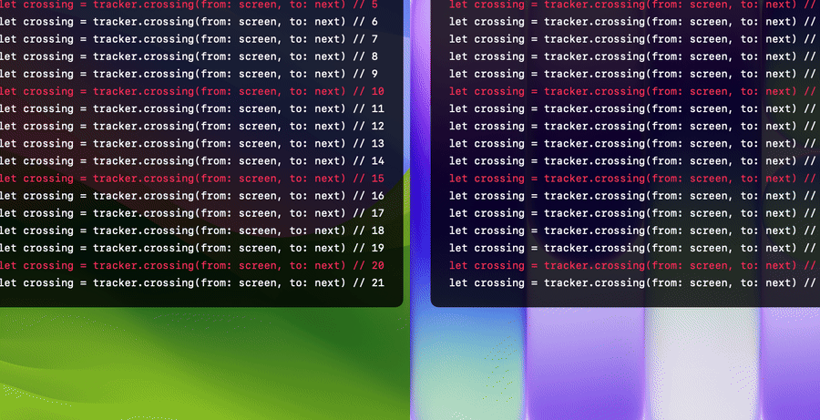
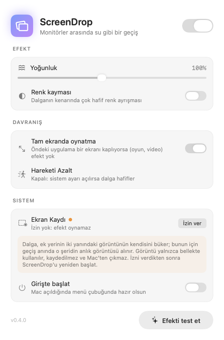

<div align="center">

# ScreenDrop

**Your displays, joined by water.**

Slide the pointer from one monitor to the next and everything at the seam, text, windows and wallpaper,<br>
ripples like jelly from the exact point you crossed, on both screens, then settles. The iOS NameDrop feeling, on a Mac.




</div>

---

## What it is

A menu bar app that plays a short, intense, liquid wobble at the seam where two displays meet, the moment your pointer crosses it.

- **Pure displacement.** Nothing is drawn on top: no ring, no glow, no shape. Only what is already on screen bends.
- **Continuous across both displays.** One wave, computed in global coordinates, so it flows over the seam.
- **About 700 ms.** Intense at the start, decaying smoothly to exactly nothing.
- **Any arrangement.** Side by side, stacked, offset heights, Retina and non-Retina, different refresh rates.

## How the illusion works

macOS doesn't let one app change how another draws, so ScreenDrop shows you a picture of the screen and bends the picture:

1. **Detect.** The pointer is polled on the display's own refresh. When it changes display, the crossing point is where its path meets the shared edge.
2. **Capture.** A 360 pt strip on each side of the seam is grabbed at once with ScreenCaptureKit, without the cursor, straight into GPU memory (IOSurface, no CPU copy).
3. **Cover.** Pre-made, click-through windows sit exactly over each strip, pixel-aligned, so frame 0 looks identical to the real screen.
4. **Ripple.** A Metal fragment shader samples the strip through an animated displacement field: a radial wave front, an organic perpendicular wobble from smooth noise, extra strength right at the seam, and a mask that fades to zero 40 pt before every other edge so no rectangle ever shows.
5. **Reveal.** When the wave has died out, the windows go away and the real screen underneath matches the last frame.

## Settings

<div align="center">
<picture>
  <source media="(prefers-color-scheme: dark)" srcset="docs/media/settings-dark.png">
  
</picture>
</div>

The menu bar holds the essentials: **Enabled**, an **Intensity** slider and **Test effect**, which plays the ripple at the middle of the first seam without moving the mouse. The settings window adds:

- **Chromatic shift**, an optional, very subtle colour split on the wave. Off by default.
- **Skip full screen**: no effect while a full-screen game or video covers either display.
- **Reduce Motion**: when it's on in macOS, the wave plays much more gently.
- **Launch at login**.

## Install

Build from source (Xcode 26 or later):

```sh
brew install xcodegen
git clone https://github.com/kutluhangil/ScreenDrop.git
cd ScreenDrop
xcodegen generate
xcodebuild -scheme ScreenDrop -configuration Release -derivedDataPath build
cp -R build/Build/Products/Release/ScreenDrop.app /Applications/
rm -rf build
open /Applications/ScreenDrop.app
```

Keep a single copy, in `/Applications`. Debug and test builds use their own bundle identifier (`com.kutluhangil.ScreenDrop.debug`), so they never mix with the installed app's permission or settings.

### Screen Recording

Bending what's on screen means taking a picture of it, so macOS asks for **Screen Recording** permission. Without it the effect doesn't play, and the settings window explains why. Each picture is a thin strip along the seam, used once in memory for that one ripple. It is never saved and never leaves your Mac. Pointer polling needs no Accessibility or Input Monitoring permission.

1. Open **Settings…** from the menu bar icon and click **Allow** (or enable ScreenDrop in System Settings → Privacy & Security → Screen & System Audio Recording).
2. Choose **Quit & Reopen** when macOS asks. The permission only applies after a restart.

The build is ad-hoc signed and macOS ties the permission to the signature, so **every rebuild needs the permission again**. Signing with your own Apple Development team keeps it across builds.

### If nothing happens

Watch the log while you cross the seam:

```sh
log stream --level info --predicate 'subsystem == "com.kutluhangil.ScreenDrop"'
```

Every crossing prints `crossing at …`, then either `capture latency … ms` (the effect played) or `skipped: …` with the reason: `disabled`, `no Screen Recording permission`, `full-screen app`. If it says no permission even though System Settings shows ScreenDrop as allowed, an older copy is holding the entry: remove ScreenDrop there with **–**, run `tccutil reset ScreenCapture com.kutluhangil.ScreenDrop`, make sure only `/Applications/ScreenDrop.app` exists, and grant it again.

## Under the hood

```
ScreenDrop/
├── Ripple.metal            the displacement shader
├── Renderer.swift          Metal pipeline and the uniforms it shares with the shader
├── StripWindow.swift       pre-made click-through window + MTKView per display
├── Capture.swift           ScreenCaptureKit → CVPixelBuffer → MTLTexture
├── Tracker.swift           display-synced pointer polling, seam crossing, cooldown
├── EffectController.swift  capture both strips, play them in sync, clean up on Spaces/sleep/rearrange
├── Geometry.swift          seams, crossing points, strips, Cocoa ↔ Quartz coordinates
└── SettingsView.swift      the settings window
```

Tune the wave in `Preferences.swift` (`Tuning`): amplitude 14 pt, speed 1400 pt/s, front width 70 pt, wavelength 90 pt, decay 0.25 s.

```sh
xcodebuild -scheme ScreenDrop -destination 'platform=macOS' test
```

The tests render the real Metal pipeline offscreen and check the hard rules: the content bends near the crossing, nothing moves at any non-seam edge, and at the end the overlay matches the screen exactly. With `TEST_RUNNER_SCREENDROP_RENDER_DIR=/some/folder` they also write the frames and screenshots used above.

**Debug mode:** `defaults write com.kutluhangil.ScreenDrop debug -bool true` outlines the strips and marks the crossing point in red, and logs capture latency and frame times (`log stream --predicate 'subsystem == "com.kutluhangil.ScreenDrop"'`).

**Measured:** on an M4 Mac mini with a 3440×1440 and a 1920×1080 display stacked, capturing both strips takes 60–105 ms. The wave starts that long after the crossing.

**Known limitations**

- For the ~700 ms of the effect, the strip shows a frozen snapshot, so a video playing right at the seam pauses for a moment.
- The low-latency mode from the spec (a continuous, low-frame-rate `SCStream` of the seam strips) isn't built yet. It would cut the start delay, at the cost of some power and the screen recording indicator staying on.

## Uninstall

```sh
osascript -e 'quit app "ScreenDrop"'
rm -rf /Applications/ScreenDrop.app
tccutil reset ScreenCapture com.kutluhangil.ScreenDrop
defaults delete com.kutluhangil.ScreenDrop
```

If you turned on **Launch at login**, turn it off in Settings first, or remove ScreenDrop from System Settings → General → Login Items.

## Credits

Inspired by Apple's NameDrop animation, studied with the help of [Martin RGB's breakdown](https://martinrgb.github.io/blog/#/Namedrop_Animation) and [Daniel Kuntz's AirDrop shader](https://gist.github.com/dkun7944/2f793643e469029fb4e7d700f0645ffc). The idea of an effect at the screen edge came from [Beamer](https://beamerapp.co.uk). Research notes, in Turkish, are in [`docs/NAMEDROP-ARASTIRMA.md`](docs/NAMEDROP-ARASTIRMA.md).

## Türkçe

ScreenDrop, imleç bir monitörden diğerine geçerken ek yerindeki yazı, pencere ve duvar kâğıdını geçiş noktasından itibaren jöle ya da su gibi dalgalandırır, iki ekranda da. Hiçbir şey çizilmez; yalnızca ekrandaki görüntü bükülür ve yaklaşık 700 ms'de yerine oturur. Menü çubuğunda çalışır. Ekran Kaydı izni yalnızca geçiş anında ek yeri boyunca ince bir şeridin görüntüsünü almak için kullanılır; görüntü kaydedilmez, Mac'ten çıkmaz. İzin uygulamanın imzasına bağlı olduğu için her yeniden derlemeden sonra yeniden verilmeli ve sistemde yalnızca `/Applications/ScreenDrop.app` kopyası bulunmalı. Efekt oynamazsa nedeni `log stream` çıktısındaki `skipped:` satırında yazar.

## License

[MIT](LICENSE) © Kutluhan Gül
