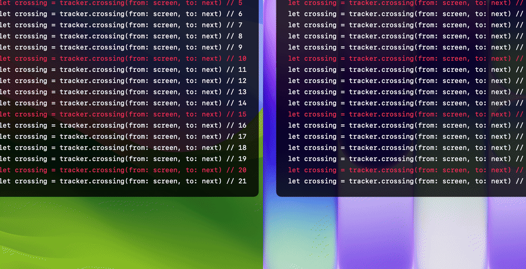
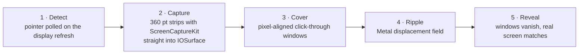
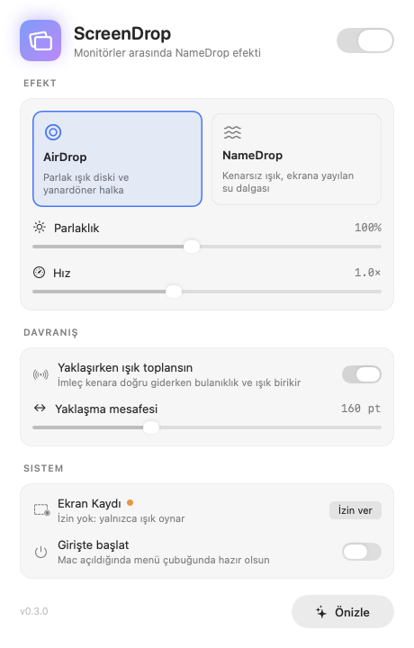

<div align="center">



<p>
  
  
  
  
</p>

<p><em>Slide the pointer from one monitor to the next and everything at the seam ripples like jelly<br>
from the exact point you crossed, on both screens, then settles. The iPhone NameDrop feeling, on a Mac.</em></p>



</div>


## What it is

A menu bar app that plays a short, intense, liquid wobble at the seam where two displays meet, the moment your pointer crosses it.

| | |
|---|---|
| **Pure displacement** | Nothing is drawn on top: no ring, no glow, no shape. Only what is already on screen bends. |
| **Continuous** | One wave in global coordinates, so it flows across both displays. |
| **About 700 ms** | Intense at the start, decaying smoothly to exactly nothing. |
| **Any arrangement** | Side by side, stacked, offset heights, Retina and non-Retina, mixed refresh rates. |


## How the illusion works

macOS doesn't let one app change how another draws, so ScreenDrop shows you a picture of the screen and bends the picture.



The shader samples the strip through an animated field: a radial wave front, an organic perpendicular wobble from smooth noise, extra strength right at the seam and a mask that fades to nothing at the strip edges.


## Settings

<div align="center">
<picture>
  <source media="(prefers-color-scheme: dark)" srcset="docs/media/settings-dark.png">
  
</picture>
</div>

The menu bar holds **Enabled**, an **Intensity** slider and **Test effect**. The settings window adds an optional chromatic shift, *Skip full screen*, gentler motion when *Reduce Motion* is on, and launch at login.


## The numbers behind the wobble

Every value is a named constant, tuned by eye and kept in one place:

| Constant | Value | Meaning |
|---|---|---|
| Amplitude | 14 pt | Peak displacement at full intensity |
| Speed | 1400 pt/s | How fast the wave front travels out from the crossing point |
| Front width | 70 pt | Width of the travelling envelope |
| Wavelength | 90 pt | Spacing of the ripples inside it |
| Decay τ | 0.25 s | Exponential fade |
| Duration | 0.7 s | After this the strips vanish and the real screen shows |
| Strip depth | 360 pt | Captured on each side of the seam |
| Strip margin | 120 pt | Overhang past the shared edge |
| Max approach | 40 pt | A crossing from further away is a jump, not a slide, and is ignored |
| Cooldown | 0.45 s | Minimum gap between two effects |
| Reduce Motion | × 0.3 | Strength when the system setting is on |
| Intensity | 0.2 – 2.0 | The menu-bar slider's range |


## Inside the app

| File | Role |
|---|---|
| `Tracker.swift` | Polls the pointer on the display refresh and detects a real seam crossing |
| `Geometry.swift` | Finds shared edges in any arrangement and maps global points to each display |
| `Capture.swift` | ScreenCaptureKit strips straight into IOSurface |
| `StripWindow.swift` | Pixel-aligned, click-through cover windows |
| `Renderer.swift` · `Ripple.metal` | The displacement field and the Metal draw |
| `EffectController.swift` | Runs one effect from capture to reveal |
| `Preferences.swift` · `SettingsView.swift` | The constants above and the settings window |

Geometry and the ripple maths have unit tests (`GeometryTests`, `RippleTests`).


## Türkçe özet

**ScreenDrop**, imleç bir monitörden diğerine geçerken ek yerindeki yazı, pencere ve duvar kâğıdını geçiş noktasından itibaren su gibi dalgalandıran bir menü çubuğu uygulaması. Üstüne hiçbir şey çizilmiyor; yalnızca ekrandaki görüntü bükülüyor ve yaklaşık 700 ms'de yerine oturuyor. Ekran Kaydı izni yalnızca o an ek yeri boyunca ince bir şeridin görüntüsünü almak için kullanılıyor; görüntü kaydedilmiyor, Mac'ten çıkmıyor.


## Install

Build from source with Xcode 26 or later:

```sh
brew install xcodegen
xcodegen generate
xcodebuild -scheme ScreenDrop -configuration Release -derivedDataPath build
cp -R build/Build/Products/Release/ScreenDrop.app /Applications/
open /Applications/ScreenDrop.app
```

Keep a single copy in `/Applications`: the Screen Recording permission is tied to the app's signature, so grant it again after each rebuild. Pointer polling needs no Accessibility or Input Monitoring permission.

<div align="center">
<br>
<a href="https://github.com/kutluhangil"></a>
<sub>MIT licensed · one Metal shader · nothing saved · nothing leaves your Mac.</sub>
</div>
