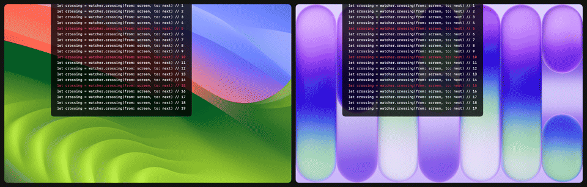

<div align="center">

# ScreenDrop

**The iPhone NameDrop moment, between your Mac's displays.**

Slide the pointer from one monitor to the next and the edge you leave gathers light,<br>
then bursts across both screens: a soft white bloom, a wave through your windows, a few sparks.




</div>

---

## Two styles

<table>
<tr>
<td width="50%" valign="top">

### AirDrop
A bright disc of light with an iridescent rim and a lens-like shockwave. The first take on the effect, closest to Apple's AirDrop animation.


</td>
<td width="50%" valign="top">

### NameDrop
No rim at all: an edgeless glow and a clear water wave that ripples the whole screen, like the iPhone's contact exchange.


</td>
</tr>
</table>

## How it plays

| | Moment | What you see |
|---|---|---|
| 1 | **Approach** | As the pointer heads for the shared edge, both screens blur and whiten right there. Stop or slide along the edge and it fades. |
| 2 | **Cross** | A soft white bloom bursts from the crossing point on both displays. |
| 3 | **Wave** | A shockwave (AirDrop) or a water wave (NameDrop) moves out through whatever is on screen. |
| 4 | **Settle** | Sparks fade, the blur dissolves, your desktop comes back sharp. |

It follows any arrangement: side by side, stacked, offset, displays of different sizes.

## Settings

<div align="center">
<picture>
  <source media="(prefers-color-scheme: dark)" srcset="docs/media/settings-dark.png">
  
</picture>
</div>

Choose the style, brightness and speed, whether light gathers on approach and from how far, and launch at login. **Preview** plays the effect on the shared edge of the display under the pointer.

## Install

Build from source (Xcode 26 or later):

```sh
brew install xcodegen
git clone https://github.com/kutluhangil/ScreenDrop.git
cd ScreenDrop
xcodegen generate
xcodebuild -scheme ScreenDrop -configuration Release -derivedDataPath build
open build/Build/Products/Release/ScreenDrop.app
```

ScreenDrop lives in the menu bar. Open **Settings…** from there.

### Screen Recording

To blur and bend what's on screen, ScreenDrop takes a picture of the display at the moment of the effect. macOS asks for **Screen Recording** permission for that. Without it, the light still plays, just without blur and wave.

The picture is used once, in memory, to draw that one effect. It is never saved and never leaves your Mac. Mouse movement is read with a standard event monitor, which needs no Accessibility permission.

## Under the hood

- **One Metal shader** (`ScreenDrop/NameDrop.metal`), run by SwiftUI's `layerEffect`, draws every layer in a single pass: stretch, wave, blur, bloom, rim and sparks.
- **ScreenCaptureKit** grabs the display. Core Image pre-blurs it once, and the shader mixes sharp and blurred by distance and time.
- **Click-through panels**, one per display at screen-saver level, show only while something plays.
- **Pure geometry** for approach and crossing, unit-tested against real layouts. Pointer warps (a jump of more than 400 pt) never trigger it.

```
ScreenDrop/
├── NameDrop.metal      the effect
├── DropFrame.swift     one frame of it, in SwiftUI
├── Coordinator.swift   pointer → approach / crossing → overlays
├── Geometry.swift      shared edges, crossings, approach charge
├── Capture.swift       ScreenCaptureKit snapshots
├── Overlay.swift       per-display panels
└── SettingsView.swift  the settings window
```

Run the tests with `xcodebuild test -scheme ScreenDrop`. To regenerate the GIFs and screenshots above, set `TEST_RUNNER_SCREENDROP_RENDER_DIR=/some/folder`.

## Credits

The layering and timing come from Apple's NameDrop animation, studied frame by frame alongside two excellent recreations:

- [Martin RGB: *How I built an iOS NameDrop animation with GLSL*](https://martinrgb.github.io/blog/#/Namedrop_Animation) ([code](https://github.com/MartinRGB/iOS17_Namedrop_R3F))
- [Daniel Kuntz: AirDrop iOS 17 shader](https://gist.github.com/dkun7944/2f793643e469029fb4e7d700f0645ffc)

The idea of an effect at the screen edge came from [Beamer](https://beamerapp.co.uk). ScreenDrop's code is its own. The research notes (in Turkish) are in [`docs/NAMEDROP-ARASTIRMA.md`](docs/NAMEDROP-ARASTIRMA.md).

## Türkçe

ScreenDrop, iPhone'daki NameDrop efektini Mac'te monitörler arasında oynatır. İmleç bir ekrandan diğerine geçerken iki ekranda da ışık, bulanıklık ve dalga oynar. Menü çubuğunda çalışır. Ayarlardan iki stil (AirDrop / NameDrop), parlaklık, hız ve yaklaşma mesafesi seçilebilir. Ekran Kaydı izni yalnızca efekt anında ekranın görüntüsünü almak için kullanılır; görüntü kaydedilmez, Mac'ten dışarı çıkmaz.

## License

[MIT](LICENSE) © Kutluhan Gül
